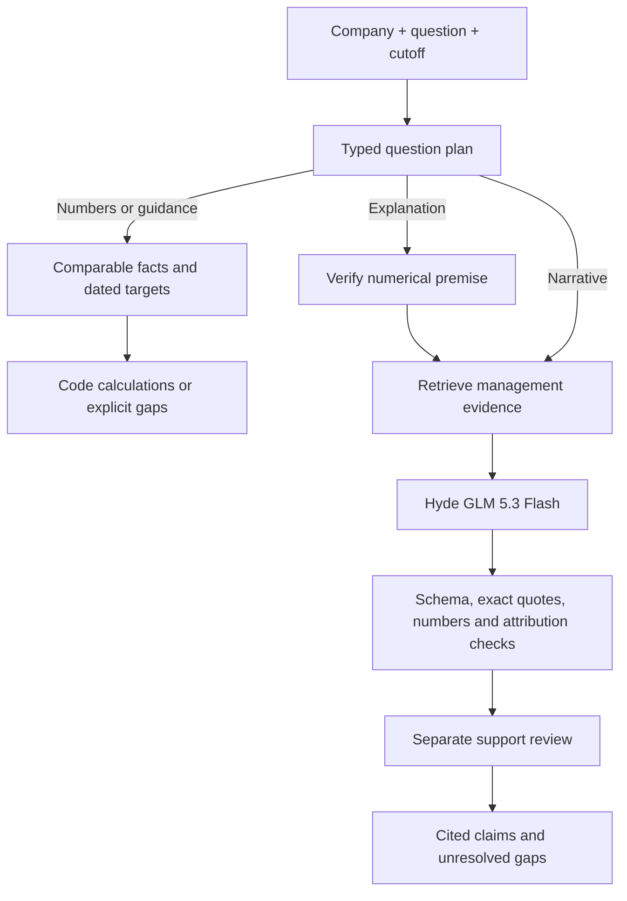

# FINN architecture

React and TypeScript run on Vinext/Vite, with a Cloudflare Worker API and D1. Sites hosts the public app and manages deployment, trusted sign-in identity and server secrets. The implementation deliberately retains this stack.

## Data and processing

A typed D1 `records` table separates source documents, passages, financial results, jobs, pages, portfolios, settings, alerts, answer caches and model budgets. Visitors receive isolated HTTP-only cookie identities unless Sites supplies a trusted signed-in identity. Source evidence is shared; visitor portfolios, jobs, preferences and read state are scoped to their owner.

The offline demonstration snapshot is separate from live D1 collection. NSE/Yahoo collectors fetch completed observations and dated exchange filings. Screener supplies discovery links only; research uses company/exchange PDFs. Fetches enforce HTTPS, host/redirect checks, size limits and company identity checks. PDFs retain content hashes, page numbers, retrieval times, parser versions and metadata receipts. Scans without usable text remain unavailable unless the separate local OCR/review workflow succeeds.

Persisted jobs use atomic duplicate prevention, expiring ownership leases and fenced final updates. A protected worker advances at most two stages per call. Failed source stages have bounded retries. Terminal research jobs save a source-versioned company page. A cloud task can continue work with no browser or local process; the browser only queues work and polls status. Portfolio monitoring is opt-in and checked every 30 minutes. See `MONITORING.md` for authorization, recovery and schedule activation.

## Answer paths

Numerical questions make no chat or embedding calls. Guidance matches period, metric, scope and reporting basis, hides future actuals and chooses the latest eligible revision. A negative or zero comparison base yields unavailable percentage growth. Margin changes use percentage points. Unsupported compound questions or annual/segment/basis requests abstain rather than silently answering another question.

Narrative retrieval first restricts company, active source revision, date and requested period. Common investor phrases expand into financial concepts. Explicit annual-report questions select annual reports. Business questions prioritize operational descriptions over auditor boilerplate. The optional embedding path uses separately configured OpenAI-shaped embeddings, index validation, bounded batches and reciprocal-rank fusion. It is disabled in production: keyword and hybrid both scored 11/12 on the small development benchmark, with different misses.

The fixed chat endpoint is Hyde's `/v1/chat/completions`, model `hyde/glm-5.3-flash`. Documents and questions are untrusted input. The model receives bounded excerpts, no execution tools, and returns structured claims with exact quotations. Each claim must pass schema, source, quote, number, period and attribution checks. A single correction can repair rejected claims; a separate model review checks support. Call-comparison repair explicitly preserves both-call citations; ordinary explanations do not inherit that contract.

Per-user and global quotas count upstream requests, including repairs/reviews. Limits default to 30/user and 100 total per UTC day. Provider calls have 35-second timeouts; each answer may require up to three calls. Answers cache for 24 hours by identity, prompt/task, question, cutoff and evidence. Cached answers and reviewed comparisons use no provider request. These checks reduce errors but cannot prove semantic correctness.

## Financial facts and changes

Reviewed examples bind exact primary-document hashes. Generic text-table extraction requires consolidated scope, explicit INR units, a quarterly column header, and consecutive current/prior/year-ago dates. The supported layout uses the first three quarterly columns and excludes YTD/annual columns. Havells' real table is a regression fixture. PAT from that table includes non-controlling interests and is distinguished from owners-attributable profit. Ambiguous or missing rows, including EBITDA, remain unavailable.

Company pages combine business excerpts, financial facts, guidance and coverage. Quarter-change cards show up to five supported changes. Reviewed narrative comparisons must match the selected financial quarters; otherwise cards are numbers-only. Call comparisons use the latest two dated indexed calls, which may not be consecutive if source coverage is incomplete. An absent mention never establishes a new or resolved risk.

## Access, failure and limits

The public worker requires a separate application credential. Local runners use `FINN_MONITOR_KEY`. The hosted task obtains the existing owner-only Sites service token through supported Sites access, sends it only to the same Site, and the application checks its SHA-256 digest stored as a server secret. Platform access alone supplies no visitor identity or connected-app consent. The task can only advance already queued jobs and opted-in portfolios; it cannot choose an arbitrary visitor or fetch private third-party information.

No secrets enter browser code, deployment manifests, source archives or schedule prompts. Rotation of the Sites token requires updating its runtime digest and redeploying; otherwise worker calls fail closed. Source failures and model failures are distinct in the UI. Failed synthesis leaves source search available. Remaining limits include partial exchange pagination, local-only OCR, incomplete generic financial/guidance coverage, provider quotas and a small development evaluation set. Historical audit documents preserve earlier failures rather than hiding them.
